

  <h1></h1>
  
Квоты Claude Code, Codex, Grok Build и Antigravity в одном виджете Windows.

  

  
Windows 10 и 11 x64 · Предварительная версия 2.0.5 · <a href="https://github.com/antonnevm-cloud">by onetone</a>

  
  

Снимки на тестовых данных. Нажмите на любой, чтобы увеличить его.

**На этой странице**

[Установка](#установка) · [Установка клиентов](#установка-клиентов) · [Подключения и вход](#подключения-и-вход) · [Проверка источника Claude](#проверка-источника-claude)

[Виджет](#виджет) · [Квоты и полные сбросы](#квоты-и-полные-сбросы) · [Диалоги и кэш](#диалоги-и-кэш) · [Недельный прогноз](#недельный-прогноз) · [Меню](#меню)

[Настроить вид](#настроить-вид) · [Все настройки](#все-настройки) · [Ручной учет бонусных сбросов Claude](#ручной-учет-бонусных-сбросов-claude)

[Аналитика](#аналитика) · [Подробно по лимитам](#подробно-по-лимитам) · [Встроенная справка](#встроенная-справка) · [Данные и лицензия](#данные-и-лицензия)

## Установка

1. В [выпуске 2.0.5](https://github.com/antonnevm-cloud/ai-limits-monitor/releases/tag/preview-2.0.5) скачайте `AI-Limits-Monitor-2.0.5-windows-x64-setup.exe`. Требуется 64-разрядная Windows 10 версии 1809 или новее либо Windows 11.
2. Запустите установщик. Можно выбрать ярлык на рабочем столе и запуск при входе в Windows. Откройте **AI Limits Monitor** из меню "Пуск".
3. В окне **Подключения и вход** включите нужных агентов. Порядок входа и проверки приведен [ниже](#подключения-и-вход).

В установщике есть среда запуска виджета. Python и Node.js для самого виджета устанавливать не нужно. Для источников квот нужны их официальные клиенты.

> В предварительной 2.0.5 зафиксирован сценарий запуска с окном Windows Terminal, при котором закрытие терминала завершает виджет.

## Установка клиентов

Установите официальные клиенты тех сервисов, которые хотите видеть в виджете. Откройте инструкции для Windows на сайтах разработчиков.

| Сервис | Что установить |
| --- | --- |
| Claude Code | Claude Code для Windows. После установки монитор ищет `claude.exe`. [Инструкция Anthropic](https://code.claude.com/docs/en/setup#install-on-native-windows) |
| Codex | Codex для командной строки. Монитору нужен исполняемый файл `codex.exe`. [Инструкция OpenAI](https://learn.chatgpt.com/docs/codex/cli) |
| Grok Build | Grok Build для Windows. В разделе Install (Установка) выберите Windows (PowerShell). После установки монитор ищет `grok.exe`. [Инструкция Grok Build](https://docs.x.ai/build/overview#install) |
| Antigravity | Приложение Antigravity для входа и клиент командной строки `agy` для квот. [Загрузка Antigravity для Windows](https://antigravity.google/download?os=windows) · [Установка agy](https://antigravity.google/docs/getting-started?tab=cli) |

## Подключения и вход

Окно **Подключения** открывается при первом запуске. Чтобы вернуться в него, нажмите **Меню** в виджете и выберите **Подключения и вход**.

На вкладке нужного клиента отметьте **Включить источник**. Чтобы перестать опрашивать этот клиент, снимите флажок и сохраните настройки. Можно включать клиентов по одному.

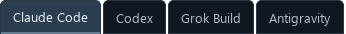

### Программа и профиль

Обычно пути находятся автоматически. Путь, показанный серым в пустом поле, монитор выбрал сам. Наведите указатель на поле, чтобы прочитать путь целиком.

В поле **Программа** укажите исполняемый файл клиента, если он установлен в нестандартной папке. Кнопка **Выбрать** справа открывает выбор файла. Для Codex на Windows подходит также `codex-x86_64-pc-windows-msvc.exe`.

В поле **Каталог данных** укажите папку того профиля, в котором работаете. Кнопка **Выбрать** здесь открывает выбор папки. Для Claude Code, Codex и Grok Build выбранный профиль используется и при запуске входа из окна.

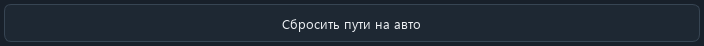

**Сбросить пути на авто** очищает ручные пути текущей вкладки. После сброса проверьте найденные пути и нажмите **Сохранить**.

### Вход и проверка

**Страница установки** появляется, если монитор не нашел программу клиента. На вкладке Antigravity она появляется и при отсутствии приложения для входа. Кнопка открывает официальный сайт разработчика.

**Войти** запускает вход средствами официального клиента. Вход и хранение учетных данных выполняет сам клиент. Когда закончите вход в терминале, браузере или приложении, вернитесь в окно подключений.

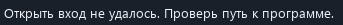

Если вход не открылся, проверьте имя и путь к программе. У Antigravity проверьте и **Приложение для входа**.

**Проверить** запускает короткую проверку выбранного клиента. Пока идет проверка, кнопка недоступна. Результат появится под кнопками.

### Claude Code

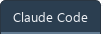

Проверьте вход в профиль Claude Code и подключите **строку состояния**. Через нее Claude Code передает монитору пятичасовой и недельный лимиты и известное время их сброса. Для стандартного профиля виджет также может брать свежие измерения из локальной истории Claude Desktop или поддерживаемого дополнения Claude.

| Ответ кнопки **Проверить** | Что он значит |
| --- | --- |
|  | Клиент подтвердил, что в выбранном профиле выполнен вход. Этот же результат показывается на вкладке Codex. |
| 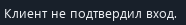 | Воспользуйтесь кнопкой **Войти** для нужного профиля, завершите вход и повторите проверку. |

**Подключить строку состояния** сразу добавляет обработчик монитора в `settings.json` выбранного профиля Claude Code. Откройте новый диалог и дождитесь первого ответа модели. Для подписки Pro или Max проценты появятся, когда Claude Code передаст данные о лимитах.

### Codex

Войдите в учетную запись ChatGPT через клиент Codex. Кнопка **Проверить** проверяет вход и показывает один из двух результатов, приведенных выше для Claude Code. Сам виджет запрашивает у клиента Codex доступные периоды квот подписки и время их сброса.

### Grok Build

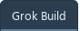

Выполните штатный вход в Grok Build. Кнопка **Проверить** запрашивает доступ к лимиту. Grok Build сообщает недельный лимит. Если запросить его временно не удается, виджет может показать последний замер из журнала Grok.

| Ответ кнопки **Проверить** | Что он значит |
| --- | --- |
|  | Клиент успешно ответил на запрос доступа к лимиту. |
|  | Проверьте профиль и вход в Grok Build, затем повторите проверку. |

### Antigravity

У Antigravity четыре пути. Крестик в заполненном поле очищает путь и возвращает автоматический поиск для этого поля.

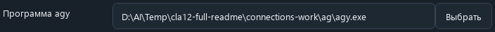

**Программа agy** указывает на `agy.exe`. В стандартном профиле монитор читает группы квот из отчета `/usage`. Для этого нужна стабильная версия `agy` 1.1.11 или новее.

**Каталог истории** задает папку локальных данных Antigravity. Обычный путь в Windows выглядит как `%USERPROFILE%\.gemini\antigravity`.

**Приложение для входа** указывает на `Antigravity.exe`. При стандартной настройке **Войти** запускает найденное приложение. Если Вы вручную указали рабочий `agy.exe` и оставили поле приложения пустым, откроется `agy`. Следуйте подсказкам открывшегося клиента.

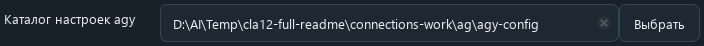

**Каталог настроек agy** указывает на папку с настройками клиента командной строки. По умолчанию монитор ищет папку `antigravity-cli` рядом с каталогом истории. При подключении строки состояния монитор записывает обработчик в `settings.json` из этой папки.

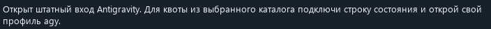

Если выбраны отдельные каталоги, выполните вход в своем профиле `agy`. Указанные в мониторе пути служат для чтения истории и настройки строки состояния этого профиля.

| Ответ кнопки **Проверить** | Что он значит |
| --- | --- |
|  | Клиент `agy` сообщил свою версию. Сам вход в учетную запись проверьте в Antigravity. |
|  | Выбранный клиент не смог сообщить версию. Проверьте, что запускается нужный `agy.exe`. |
| 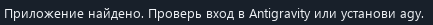 | Монитор нашел приложение для входа. Чтобы получить квоты, установите `agy` или укажите путь к нему. |

Подключите **строку состояния**, если `/usage` недоступен или Вы используете отдельный профиль. Затем откройте новую сессию `agy` в том же профиле и дождитесь первого измерения.

### Сообщения о путях, проверке и строке состояния

| Что показано | Как прочитать |
| --- | --- |
|  | Монитор нашел исполняемый файл и папку профиля. Вход проверяется отдельной кнопкой **Проверить**. |
| 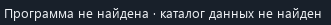 | Установите клиент или укажите пути вручную. При первом входе клиент может сам создать стандартную папку профиля. |
|  | У Antigravity строка дополнительно сообщает, найдено ли приложение для входа. |
|  | Чтобы получать данные от этого клиента, поставьте флажок **Включить источник** и сохраните настройки. |
| 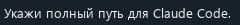 | Введите полный путь или воспользуйтесь кнопкой **Выбрать**. |
|  | Выберите исполняемый файл клиента, указанный в сообщении. |
|  | Проверьте, что выбранный файл запускается в Windows и доступен Вашей учетной записи. |
|  | Откройте клиент напрямую и проверьте сообщение об ошибке. |
|  | Дождитесь завершения входа или первоначального запуска клиента и повторите проверку. |
| 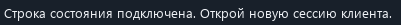 | Откройте новую сессию в выбранном профиле клиента. |
|  | Запись уже есть. Для получения свежего замера поработайте в выбранном профиле. |
|  | Монитор оставил Вашу команду в профиле. Чтобы использовать обе команды Claude Code, добавьте обработчик монитора в свою команду вручную. |
|  | Проверьте путь к профилю и доступ к его `settings.json`. У Antigravity этот файл находится в **Каталоге настроек agy**. |

### Сохранение

**Сохранить** применяет настройки всех вкладок и запускает обновление виджета. **Отмена** закрывает окно без сохранения его настроек. Команда **Подключить строку состояния** меняет файл клиента сразу при нажатии.

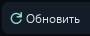

Чтобы повторить запрос квот после работы в клиенте, нажмите **Обновить**.

## Проверка источника Claude

Откройте **Меню** и выберите **Claude · проверить источник...**. Окно **Claude · проверка данных** сверяет запись строки состояния в `settings.json` текущего профиля Claude Code и читает последний снимок, если он есть. Проверка выполняется по локальным файлам и работает без сети.

| Что показано | Что это значит |
| --- | --- |
|  | Для текущего профиля требуется подключить локальную строку состояния. Откройте вкладку **Claude Code** в окне подключений или выберите пункт меню ниже. |
|  | Откройте новый диалог Claude Code, дождитесь ответа модели и обновите виджет. |
| 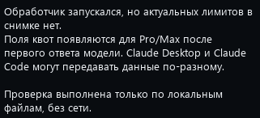 | Файл снимка есть, но пригодных данных о лимитах в нем сейчас нет. Проверьте профиль и подписку Pro или Max, затем получите новый ответ модели. |
| 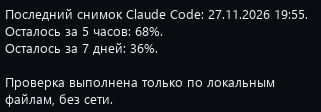 | Время последнего измерения и остаток за 5 часов и 7 дней. Прочерк означает, что для этого периода нет пригодного числа. |
| 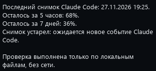 | На экране последнее измерение. Поработайте в Claude Code, чтобы обновить его. |
|  | Проверьте доступ к файлу settings.json нужного профиля и формат настроек. Подробности сбоя указаны в сообщении. |

**OK** закрывает результат проверки.

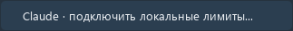

**Claude · подключить локальные лимиты...** открывает подтверждение настройки для текущего профиля Claude Code. Этот пункт пригодится, если проверка показала, что запись строки состояния отсутствует или относится к прежней версии монитора.

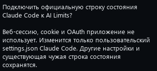

Подтвердите подключение кнопкой **Yes** (Да), чтобы добавить обработчик. **No** (Нет) закрывает вопрос. При обнаружении другой команды строки состояния монитор оставит ее в профиле.

## Виджет

| Фрагмент | Где и как работает |
| --- | --- |
|  | Потяните за заголовок, чтобы переместить окно. |
| 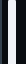 | Потяните за ручку на левом или правом краю. Ширина запоминается. |
| 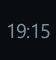 | Часы справа вверху показывают местное время. |
|  | **Скрыть** убирает виджет в область уведомлений. Чтобы вернуть окно, нажмите значок рядом с часами Windows. |
| 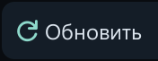 | **Обновить** запрашивает свежие данные квот. |
| 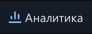 | **Аналитика** открывает отчет за выбранные даты. |
|  | **Меню** открывает список команд. Тот же список доступен из значка в области уведомлений. |
| 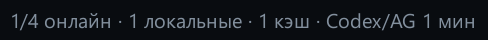 | Внизу видны число источников в состоянии "онлайн", число локальных и сохраненных снимков и интервал опроса Codex и Antigravity. |
|  | Подпись автора в нижней строке. |
| 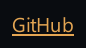 | Ссылка на проект в нижней строке. |

## Квоты и полные сбросы

| Фрагмент | Где и что показывает |
| --- | --- |
|  | Зеленая точка рядом с именем агента означает состояние "онлайн". |
|  | Голубая точка означает резервные локальные данные. |
|  | Желтая точка означает последний сохраненный снимок квоты. |
| 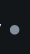 | Серая точка означает отсутствие данных. Наведите указатель на точку, чтобы увидеть источник, время замера или причину сбоя. |
|  | Число в скобках после имени - сколько показываемых диалогов сейчас выполняется. В примере работает один диалог. |
|  | `5 ч 64%` справа в карточке означает остаток пятичасовой квоты. `нед` обозначает недельную квоту. При остатке ниже 50% число желтое, ниже 20% красное. |
|  | Красное число показывает малый остаток. `0%` означает, что лимит исчерпан. |
|  | Прочерк означает, что значения пока нет. |
|  | Время под процентом показывает, через сколько обновится именно это окно квоты. Строка появляется, когда известен срок сброса. |
| 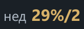 | В `нед 29%/2` осталось 29% недельного лимита, а `/2` означает два доступных **полных сброса**. Число добавляется при известном положительном остатке сбросов к основному показателю. |
| 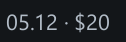 | Дата и сумма под именем агента относятся к следующему ежемесячному платежу. Они рассчитываются из даты последней оплаты и суммы, введенных в настройках. |
|  | У Claude Code, Codex и Grok Build стрелка открывает диалоги, если включены их таймеры. У Antigravity открываются группы или модели с квотами. |

У Codex и Grok зеленое состояние может сохраняться до 15 минут после короткого сбоя источника. В этот период подсказка у точки указывает время последнего замера.

### Когда появляется "успей использовать"

Напоминание появляется **под карточкой агента**, если есть доступный полный сброс с известной датой сгорания и до ближайшего срока осталось **меньше 14 суток**.

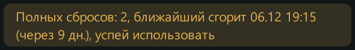

**Желтая строка** появляется, когда до ближайшего срока осталось **не меньше 3 суток** и **меньше 14 суток**. В примере доступно два сброса, а ближайший сгорит через 9 дней.

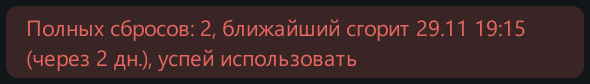

**Красная строка** появляется, когда осталось **меньше 3 суток**. В обеих строках указаны местная дата и время ближайшего сгорания. Ровно за 14 суток, при неизвестном сроке или с момента его истечения эта строка не показывается.

### Раскрытая карточка Antigravity

| Фрагмент | Где и что показывает |
| --- | --- |
|  | Название группы или модели. В свернутой карточке показывается выбранная группа. Режим выбора задается в общих настройках. |
| 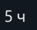 | **Лимит** обозначает период квоты, например пять часов или неделю. |
|  | **Остаток** показывает доступную часть квоты этой группы и периода. |
|  | **Сброс** показывает местные дату и время. Когда источник их не передал, в ячейке указано "нет даты". |

## Диалоги и кэш

Внешняя дуга показывает оставшееся время жизни кэша контекста. Дуга становится короче, от зеленой при остатке от 60% срока переходит через желтый к красному. Маленький индикатор состояния в компактном режиме расположен **внутри кольца над временем**, в полном режиме - рядом с названием диалога.

| Фрагмент | Где и что показывает |
| --- | --- |
| 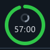 | Серый индикатор **вращается**, пока агент выполняет запрос. В примере кэш еще живет 57 минут. |
|  | Оранжевая точка означает ожидание Вашего ответа. Знак `~` перед таймером означает примерное время остывания. |
| 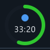 | Синяя точка означает, что ход завершен, ответ еще не просмотрен. |
|  | Числа внутри кольца показывают минуты и секунды до остывания. Пустой индикатор состояния означает, что отдельный статус диалога не распознан. |
|  | Подпись `остыл` и серая окружность означают, что срок кэша вышел. Недавно остывшие диалоги обычно остаются в списке до десяти минут. |
| 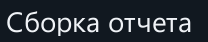 | Верхняя строка - название диалога. |
| 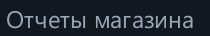 | Под названием - проект. Среда запуска и время последнего запроса видны в подсказке строки. |
| 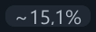 | `~15,1%` - оценка части недельной квоты, потраченной этим диалогом. Расчет использует расход аккаунта и распределяет его по стоимости токенов из локальной истории. |
| 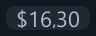 | `$16,30` - условная стоимость токенов по опубликованным тарифам доступа к моделям. Суффикс `+` сообщает, что часть токенов осталась без цены. Оплату подписки показывает поставщик. |
|  | Значок монеты показывает оценку цены повторной записи контекста в кэш после остывания. |
|  | Пламя отмечает диалог с наибольшей оценкой расхода недельной квоты в списке этого агента. |
|  | **Показать еще** раскрывает остальные строки. |
| 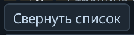 | **Свернуть список** возвращает краткий вид. |
| 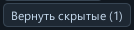 | **Вернуть скрытые** появляется, когда список учитывает правила скрытия. Возвращает скрытые диалоги этого агента. |

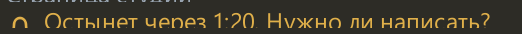

**Колокольчик** появляется под диалогом, если включено предупреждение и до остывания осталось не больше двух минут.

## Недельный прогноз

| Фрагмент | Где и что показывает |
| --- | --- |
|  | Полоса идет от начала недели до сброса. Ярко-синяя часть заканчивается в текущем времени. Приглушенно-синяя показывает, сколько еще продержится лимит. Красная отмечает время после прогнозируемого исчерпания и до сброса. |
| 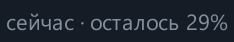 | Слева под полосой виден остаток недельной квоты сейчас. |
|  | Зеленое число после времени сброса - ожидаемый остаток при текущем темпе. |
|  | Красное время рядом с `кончится` показывает, когда ожидается исчерпание. `сброс` показывает время обновления квоты. |
| 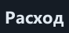 | Нажмите на полосу или **Расход**, чтобы открыть график по проектам. |
|  | При наведении на полосу появляется подсказка. График открывается по щелчку. |

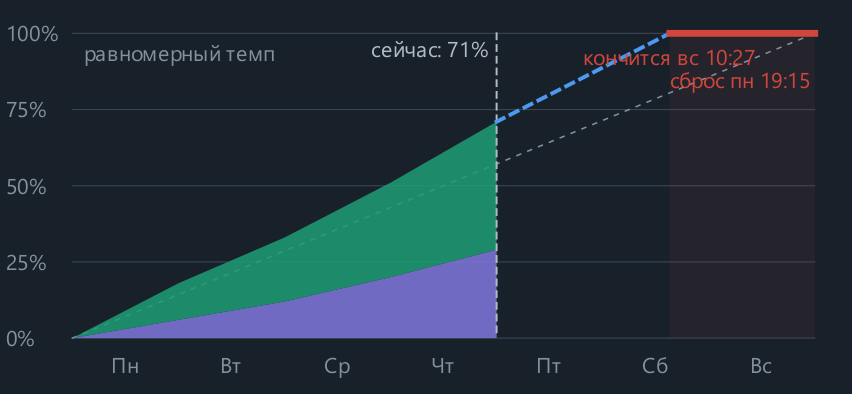

На графике слева направо идут дни недели лимита. Высота области показывает накопленный процент. Цвета разделяют оценочный расход по проектам.

| Фрагмент | Что показывает |
| --- | --- |
|  | **Израсходовано** - использованный процент недели на момент замера. |
| 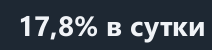 | **Темп** - средний или рассчитанный по замерам расход в сутки. При недостатке замеров показывается подпись "мало данных". |
| 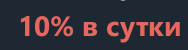 | **Можно до сброса** - сколько можно тратить в сутки, чтобы остатка хватило. |
| 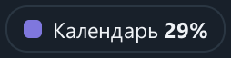 | Легенда связывает цвет с проектом. Наведите указатель на проект, чтобы выделить его долю и увидеть пояснение. |
|  | Закрывает график. То же делает клавиша Escape. |

## Меню

| Фрагмент | Действие |
| --- | --- |
|  | Открывает панель вида виджета. |
|  | Открывает общие настройки окна, агентов и платежей. |
|  | Открывает настройки источников и штатного входа в клиенты. |
| 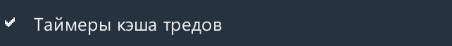 | Включает или выключает отображение диалогов с таймерами кэша. |
|  | Возвращает скрытый виджет на экран. |
| 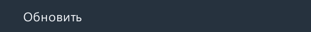 | Запрашивает обновление квот, как верхняя кнопка виджета. |
|  | Открывает доступные окна и пулы квот каждого агента. |
|  | Открывает историю расхода по выбранному периоду. |
| 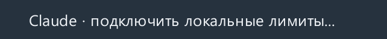 | Настраивает передачу локальных лимитов от Claude Code через его строку состояния. |
|  | Показывает, откуда получены квоты Claude, и помогает проверить настройки передачи. |
| 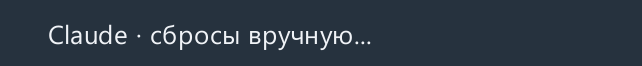 | Открывает ручной учет доступных полных сбросов Claude. |
|  | Открывает встроенное руководство. То же делает F1. |
|  | Завершает работу виджета. |

## Настроить вид

Откройте меню виджета и выберите **Настроить вид**. Изменения сохраняются сразу. Чтобы увидеть их в списке тредов (чатов и сеансов), раскройте карточку Claude, Codex или Grok. Для списков должна быть включена команда **Таймеры кэша тредов**.

| Фрагмент интерфейса | Что меняет |
| --- | --- |
|  | **×** закрывает панель **Вид тредов**. |
|  | **Компактно** размещает название треда и строку с проектом и показателями расхода плотнее. Кольцо таймера становится меньше. |
|  | **Время жизни кэша** показывает кольцо с обратным отсчетом до истечения срока кэша. |
|  | **Название треда** показывает название чата или сеанса в строке. |
|  | **Проект и среда** показывает проект и приложение или способ запуска треда. |
|   | **Расход треда** показывает оценку его доли недельного лимита, оценку стоимости токенов по тарифам для разработчиков в долларах или обе цифры. Выберите **нет**, чтобы скрыть расход. |
|  | **Цена остывания** показывает расчетную стоимость повторной записи контекста после истечения срока кэша, когда есть данные для расчета. |
|  | **Предупреждение** выделяет строку в последние две минуты жизни кэша. |
|  | **Подсветка прожорливого** отмечает тред с наибольшей оценкой расхода недельного лимита. Значок появляется, если есть положительные оценки хотя бы для двух тредов. |
|  | **Учитывать правила тредов** поднимает закрепленные треды вверх и убирает скрытые из списка. |
|  | **Claude Code из терминала** включает в список сеансы Claude Code из терминала и запуски из скриптов. Они также учитываются в счетчике работающих тредов. |
|  | **Прогноз недели** добавляет полосу прогноза к раскрытой карточке, когда есть данные о недельном лимите. |
|   | **График расхода** открывает график по щелчку на полосе прогноза. Чтобы отключить открытие, выберите **выключен**. |
|   | **Размер шрифта** меняет размер текста в виджете, этой панели и графике. Вариант **как было** возвращает обычный размер. |
|  | **Прозрачность окна** задает видимость окна вместе с текстом от 20 до 100% с шагом 10%. При 100% окно непрозрачно. |
|  | **Все настройки** открывает одноименное окно. |

## Все настройки

Откройте **Все настройки** из меню виджета или по ссылке в панели **Вид тредов**.

| Фрагмент интерфейса | Что меняет |
| --- | --- |
|   | **Опрос Codex и Antigravity** задает, как часто виджет получает данные об их лимитах. |
|   | **Прозрачность окна** задает то же значение, что и ползунок в **Настроить вид**. В этом окне значение меняется после сохранения. |
|  | **Поверх остальных окон** удерживает виджет поверх окон других программ. |
|  | **Показывать** управляет карточками компактного виджета. Отметьте Claude, Codex, Grok или Antigravity, чтобы их карточки были видны. |
|  | **Подключения и вход** открывает отдельное окно, где можно выбрать путь к клиенту или профилю и включить либо выключить источник данных. |
|   | **Antigravity · группа в заголовке** появляется при наличии групповых лимитов. Выберите группу вручную или оставьте **Авто: минимальный остаток**. Автовыбор показывает группу с наименьшим остатком на неделю. Если недельных лимитов нет, сравниваются пятичасовые. Если выбранная вручную группа пропадет из данных, сработает автовыбор. |
|   | **Antigravity · модель по умолчанию** появляется, когда групповых лимитов нет. **Авто: самая используемая сегодня** берет модель с наибольшим расходом токенов за день. **Авто: последняя использованная** берет последнюю модель из истории на этом компьютере за последние семь дней. **Фиксированная модель** показывает выбранную ниже модель. **Самый израсходованный лимит** показывает модель с наименьшим процентом остатка. |
|   | Список моделей заполняется по данным о лимитах. Выбранная модель влияет на заголовок в режиме **Фиксированная модель**. Если ее лимит недоступен, виджет попробует показать последнюю использованную модель, затем модель с наименьшим остатком. |
|  | **Последняя оплата** принимает дату в формате **ДД.ММ** по каждому агенту. Следующий платеж приходится на то же число следующего месяца или на его последний день, если такого числа нет. |
|  | **Сумма** хранит число и валюту, например **20 $**. Заполните дату и сумму, чтобы платеж был виден в карточке. Чтобы убрать его, очистите оба поля. |
|  | **Сохранить** применяет общие настройки. |
|  | **Отмена** закрывает окно и отбрасывает правки. |

## Ручной учет бонусных сбросов Claude

Откройте меню виджета и выберите **Claude · сбросы вручную...**. В окно **Claude · бонусные сбросы** внесите бонусы **Reset for free** (бесплатный сброс) из раздела **Usage** (расход) в настройках Claude. Каждая строка учитывает один бонус. После использования бонуса удалите его вручную. Записи со сроком автоматически перестают учитываться, когда срок истекает.

| Фрагмент интерфейса | Что делает |
| --- | --- |
|  | **Доступные бонусы** показывает добавленные записи и их число. В списке можно выбрать одну запись для изменения срока или удаления. Всего можно добавить до 30 бонусов. |
|  | Введите местные дату и время окончания. Нажмите правый край поля, чтобы выбрать день в календаре. |
|  | Выберите день в календаре. Срок должен быть в будущем. |
|  | **Добавить по дате** добавляет один бонус с указанным сроком. |
|  | **Без срока** добавляет бонус без даты окончания. |
|  | **Изменить срок** заменяет срок выбранной записи датой и временем из поля. Так можно указать срок и для записи **Без срока действия**. |
|  | **Удалить выбранный** убирает выбранную запись из списка. |
|  | **Сохранить** записывает список для текущего профиля Claude и обновляет счетчик в карточке. |
|  | **Отмена** закрывает окно и отбрасывает правки. |

## Аналитика

Нажмите **Аналитика** в виджете или **Детальная аналитика** в меню значка рядом с часами Windows. Окно **AI Usage** показывает расход по локальной истории выбранного агента. На снимках тестовые данные.

### Фильтры и расчет

| Фрагмент | Что показывает или делает |
| --- | --- |
|   | **Агент** выбирает источник данных. В списке доступны Claude Code, Codex, Grok Build и Antigravity. |
|   | **Период** задает диапазон расчета. Есть готовые варианты для дня, недели и месяца, скользящие интервалы 5 часов, 24 часа и 7 дней, а также **Произвольный период**. |
|  | **Начало** задает первую дату и время произвольного периода по местным часам. Граница входит в расчет. |
|  | **Конец** задает последнюю дату и время произвольного периода по местным часам. Граница входит в расчет. |
|  | **Поиск** находит совпадения в названии диалога или проекта независимо от регистра. Он сужает список **Тредов** и ветки **Обзора**. Карточки и сводки считают весь набор за выбранный период. |
|  | **Показывать скрытые** включает скрытые диалоги в списки и суммы. |
|  | **Рассчитать** перечитывает локальную историю. Нажмите после изменения дат или текста поиска. В поиске также работает **Enter**. Смена агента, периода или показа скрытых запускает расчет сразу. |
|  | **Экспорт** сохраняет результат последнего расчета в файл. |
|  | Внизу окна указаны время расчета, число проектов и показанных тредов, время снимка квоты и сообщения источника. |

### Карточки над вкладками

| Фрагмент | Что показывает или делает |
| --- | --- |
|  | **Токены** показывают объем обработки за выбранный период, включая запросы, ответы и операции с кэшем, если эти счетчики доступны. |
|   | **Условная стоимость** оценивает расход в долларах по тарифам моделей. Фактическую сумму оплаты показывает поставщик. Для Antigravity при отсутствии цены в карточке виден прочерк, в таблицах $0,00. |
|  | **Треды** показывают число рабочих диалогов. Объединенная задача считается одной строкой. Под числом видны проекты. |
|   | **Недельная квота** в Claude Code и Codex показывает использованный процент текущего основного окна. 71% в аналитике соответствует 29% остатка в виджете. |
|  | **Пятичасовое окно** показывает, сколько уже использовано в текущем пятичасовом окне Claude Code. |
|  | **Расход лимита** оценивает расход основного окна за выбранный период в п.п. (процентных пунктах). Если остаток снизился с 80% до 65% без сброса, расход равен 15 п.п. **н/д** означает, что для оценки не хватает замеров. |
|  | **Codex Spark** показывает использованный процент отдельного недельного пула, когда эта квота доступна. |
|  | **Grok · неделя** показывает использованный процент общей недельной квоты Grok Build. |
|  | **Сброс недели** показывает ближайший известный сброс Grok Build по местному времени. |
|   | В первой карточке **Antigravity** виден использованный процент основного окна. В заголовке карточки указано имя модели или группы. |
|   | **Модельных пулов** показывает число полученных окон моделей и ближайший известный сброс. Если источник передал только групповые окна, здесь и в столбцах лимитов отдельных моделей стоят прочерки. |
|   | **Расход лимитов** показывает число отдельных окон, для которых удалось рассчитать расход. В примере с групповыми данными замеры есть у четырех окон двух групп. Их остатки и сроки сброса видны в **Подробно по лимитам**. |

### Вкладки аналитики

Чтобы отсортировать таблицу, нажмите заголовок столбца.

#### Обзор

| Фрагмент | Что показывает или делает |
| --- | --- |
|  | **Проект / тред** показывает проект и его диалоги. Раскройте проект для просмотра диалогов. Двойной щелчок по диалогу открывает детализацию. |
|  | **Модели** перечисляет модели диалога или проекта. |
|  | **Тредов** показывает число диалогов в видимой ветке проекта. |
|  | **Токены** показывает объем обработки в строке. Для модели это сумма ввода, вывода, создания и чтения кэша. |
|  | **Стоимость** показывает условную цену расхода в строке. |
|  | **Доля** считается от общей стоимости периода, а при ее отсутствии от токенов. |
|  | **Лимит, п.п.** оценивает расход квоты проекта или диалога. Например, доля 64% от общего расхода 25 п.п. дает проекту около 16 п.п. Для Antigravity оценка приводится по отдельным пулам, когда есть замеры. |
|  | **Последняя активность** показывает время последней записи в локальной истории. Для проекта берется самая поздняя запись среди диалогов в его ветке. |
|  | **★** отмечает закрепленный диалог. |
|  | **(+2)** означает двух субагентов. |

#### Треды и действия с диалогами

В списке есть отдельные диалоги и объединенные задачи. **Модели**, **Токены**, **Стоимость**, **Доля** и **Лимит, п.п.** читаются так же, как в **Обзоре**.

| Фрагмент | Что показывает или делает |
| --- | --- |
|  | **Тред** показывает название диалога или объединенной задачи. |
|  | **Проект** показывает, к какому проекту относится диалог. |
|  | **Субагенты** показывает их число. Для диалогов без субагентов ячейка пустая. |
|  | **Начало** показывает время первой зарегистрированной активности. |
|  | **Конец** показывает время последней зарегистрированной активности. |

Щелкните по диалогу правой кнопкой в **Обзоре** или **Тредах**, чтобы открыть меню.

| Фрагмент | Что показывает или делает |
| --- | --- |
|  | **Переименовать** задает свое имя для одного диалога. |
|  | **Скрыть** убирает выделенные диалоги из обычного расчета. |
|  | **Показать** возвращает скрытые диалоги. Чтобы добраться до команды, включите **Показывать скрытые** и выделите нужные строки. |
|  | **Закрепить** отмечает выделенные диалоги звездочкой. |
|  | **Открепить** снимает отметку. |
|  | **Объединить в задачу** собирает выделенные диалоги в одну строку с общим названием. |
|  | **Снять объединение** возвращает отдельные строки. |
|  | **Открыть детализацию** показывает сведения о выбранном диалоге. Туда же ведет двойной щелчок по строке. |

| Фрагмент | Что показывает или делает |
| --- | --- |
|  | **Агент** указывает, из чьей истории взят диалог. В этом же окне собраны его показатели из **Обзора** и **Тредов**. |
|  | **Динамика внутри выбранного периода** разбивает токены и условную стоимость только этого диалога по интервалам. |
|  | **Close** (Закрыть) возвращает в основное окно. |

#### Проекты

Каждая строка суммирует диалоги одного проекта. Повторяющиеся столбцы читаются так же, как в **Обзоре**.

Чтобы открыть диалоги проекта или модели, щелкните правой кнопкой по его названию и выберите **Показать треды**.

#### По времени

Высота столбца на графике соответствует числу токенов за интервал.

| Фрагмент | Что показывает или делает |
| --- | --- |
|  | **Интервал** показывает начало часа для периода до 48 часов включительно. Для более длинного периода показывает дату. |
|  | **Стоимость** распределяется по интервалам пропорционально токенам диалогов и дает оценку. |

#### Модели

| Фрагмент | Что показывает или делает |
| --- | --- |
|  | **Модель** показывает название модели из истории. |
|  | **Ввод** показывает токены запросов. |
|  | **Вывод** показывает токены ответов. |
|  | **Кэш создан** показывает токены, записанные в кэш. |
|  | **Кэш прочитан** показывает токены, повторно прочитанные из кэша. |
|  | **Лимит** показывает использованный процент текущего окна модели Antigravity. |
|  | **П.п. периода** дает оценку расхода окна модели Antigravity по замерам за выбранный период. |
|  | **Сброс** показывает время обновления окна модели Antigravity по местным часам. |

Поля окна Antigravity заполняются при наличии данных по конкретной модели.

### Экспорт отчета

Нажмите **Экспорт**, укажите имя файла и выберите формат.

| Фрагмент | Что показывает или делает |
| --- | --- |
|  | **Excel (.xlsx)** сохраняет сводку и листы по диалогам, проектам, времени и моделям. |
|  | **HTML (.html)** (HyperText Markup Language, язык разметки веб-страниц) создает страницу с карточками и таблицами. |
|  | **JSON (.json)** (JavaScript Object Notation, формат структурированных данных) сохраняет данные для последующей обработки, включая окна квот. |
|  | **CSV (.csv)** (Comma-Separated Values, формат значений с разделителями) выгружает список тредов для электронной таблицы. |

## Подробно по лимитам

В меню значка рядом с часами Windows выберите **Подробно по лимитам**. Окно показывает остатки квот, отдельные пулы и группы.

| Фрагмент | Что показывает или делает |
| --- | --- |
|  | Под заголовком указан интервал опроса Codex и Antigravity. |
|  | **Обновить** запрашивает свежие данные. |
|  | **Настройки** открывает выбор строк, интервала и положения окна. |
|  | **Агент / модель** показывает название агента, модели или группы. Подписка видна в заголовке секции, если источник ее передал. |
|   | **Короткий / день** показывает короткое окно, например 5 часов. |
|   | **Долгий / неделя** показывает длинное окно, например неделю. |
|  | **Нет окна** означает, что для этого окна нет данных. |
|  | **Сброс не указан** означает, что остаток известен, а источник не передал срок сброса. |

Полоса показывает остаток. Она зеленая выше 45%, желтая выше 20% и до 45% включительно, красная при 20% или меньше. Число округляется до целого. 0% означает, что лимит исчерпан.

### Состояния источника

| Фрагмент | Что показывает или делает |
| --- | --- |
|  | **LIVE** означает, что источник считается доступным. |
|  | **КЭШ** обозначает сохраненный снимок. Рядом показаны дата и время замера. |
|  | **ЛОКАЛЬНЫЕ ДАННЫЕ** указывает запасной источник на компьютере. |
|  | **НЕТ ДАННЫХ** означает, что снимка квоты нет. |

### Окна и пулы агентов

| Фрагмент | Что показывает или делает |
| --- | --- |
|  | **Claude** показывает основное пятичасовое и недельное окна. В примере доступно 64% и 29% соответственно. |
|  | **Fable** в примере занимает дополнительное недельное окно с остатком 88%. |
|  | **Codex** показывает основные короткое и недельное окна. |
|  | **Codex Spark** может иметь отдельное короткое окно. В примере доступно 79%. |
|  | Недельный **Codex Spark** отображается на отдельной строке. В примере доступно 92%. |
|  | **Grok** показывает общее недельное окно. В примере с резервными локальными данными доступно 62%. |
|  | При групповых данных Antigravity объединяет окна в одной строке. У **Gemini Models** на снимке осталось 67% пятичасовой и 28% недельной квоты. |
|  | **Claude and GPT models** показывает остатки другой группы. В примере 83% пятичасовой и 61% недельной квоты. |
|  | При данных по отдельным моделям **Модельный пул** показывает квоту конкретной модели и известный срок сброса. |
|  | **Консольный лимит** появляется отдельной строкой, если источник передал общую квоту вместо групп или отдельных моделей. В примере время сброса не указано. |

### Кредиты ручного сброса

**Кредиты ручного сброса** показывают количество, известные сроки по каждому кредиту, источник и актуальность. **0 доступно** означает отсутствие кредитов. **Нет данных** означает, что источник не сообщил число. Если известна только часть сроков, выводится число кредитов без даты и ближайший известный срок. Наведите указатель, чтобы увидеть подсказку. При сроке меньше трех суток выделение желтое. При сроке меньше 24 часов красное.

Такая же панель доступна у Codex, когда есть сведения о кредитах.

### Строка состояния

| Фрагмент | Что показывает или делает |
| --- | --- |
|  | В строке видны время последнего снимка, число строк, локальных и сохраненных источников. **live 2/4** означает два доступных источника из четырех. |
|  | Справа указана версия окна подробных лимитов. |

### Настройки подробных лимитов

| Фрагмент | Что показывает или делает |
| --- | --- |
|   | **Опрос Codex и Antigravity** предлагает 15 или 30 секунд, 1, 2 или 5 минут. |
|  | **Поверх остальных окон** удерживает это окно поверх других. |
|  | Флажок агента переключает все его строки в списке **Агент / модель**. |
|  | Флажок внутри группы переключает отдельное окно или пул. Включите нужные строки дополнительных пулов Claude и Codex, чтобы видеть их в окне. |
|  | **Показать все** включает все строки. |
|  | **Скрыть все** выключает все строки. |
|  | **Save** (Сохранить) применяет настройки. |
|  | **Cancel** (Отмена) закрывает окно без применения. |

## Встроенная справка

Нажмите **F1** в активном виджете или выберите **Меню → Справка**. Справка доступна без интернета и открывается даже без подключенных клиентов.

| Вкладка | Что в ней |
| --- | --- |
|  | Установка виджета и подключение первого клиента. |
|  | Откуда берутся лимиты каждого клиента и когда нужна строка состояния. |
|  | Проценты остатка, время сброса, стрелки, прогноз и управление окном. |
|  | Расход квоты, данные аналитики и папка с настройками и измерениями. |
|  | Как отличить пустое значение от нуля и где проверить пути и вход. |

**GitHub** открывает исходный проект в браузере.

**Закрыть** возвращает в виджет.

## Данные и лицензия

Настройки и измерения хранятся в `%LOCALAPPDATA%\ClaudeUsageManager`. Историю диалогов виджет читает из выбранных локальных профилей. Вход и хранение учетных данных выполняет официальный клиент агента.

[Лицензия](LICENSE) объединяет Apache 2.0 и Commons Clause 1.0. Можно пользоваться программой, делать форки, менять код и распространять сборки бесплатно. При распространении сохраняйте лицензию и [NOTICE](NOTICE) с псевдонимом автора и ссылкой на исходный проект. Для продажи программы или ее перепаковки, подпадающей под условия лицензии, нужно отдельное разрешение. Условия платного распространения можно согласовать через [GitHub](https://github.com/antonnevm-cloud).

[Сборка из исходников для Windows](packaging/README.md#windows-x64) · [Лицензии компонентов](packaging/licenses/README.md)
