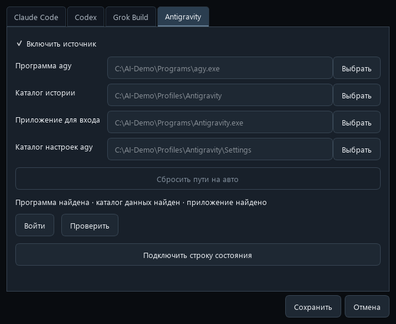
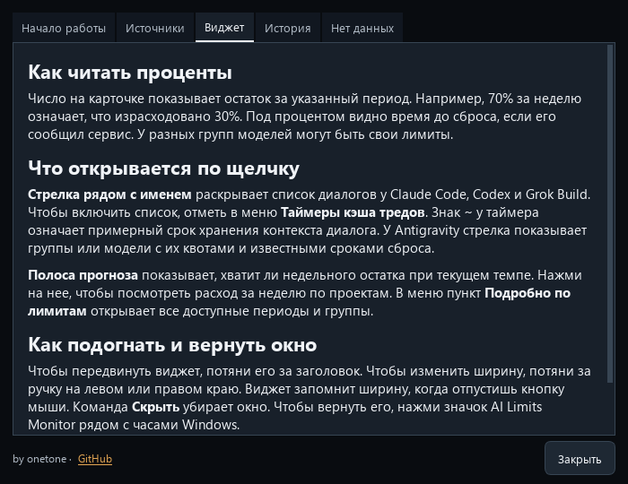

<h1></h1>

[by onetone](https://github.com/antonnevm-cloud)

Я сделал AI Limits Monitor, чтобы видеть, сколько осталось до исчерпания лимита и когда он обновится. В виджете виден остаток по периодам и группам моделей. Чтобы понять, куда ушел лимит, можно открыть историю расхода по проектам, диалогам и моделям.

[Подключить сервисы](#подключение-сервисов) · [Посмотреть аналитику](#аналитика-и-история)

  

На снимках показаны тестовые данные.

## Установка в Windows

Установщик для 64-разрядных Windows 10 версии 1809 и новее и Windows 11 доступен в [разделе выпусков](https://github.com/antonnevm-cloud/ai-limits-monitor/releases). Скачайте файл с окончанием `windows-x64-setup.exe` и запустите его. Программа установится для текущего пользователя. В установщике можно выбрать ярлык на рабочем столе и запуск при входе в Windows.

Откройте AI Limits Monitor из меню "Пуск". При первом запуске появится окно **Подключения и вход**. Позже его можно открыть из меню виджета.

В установщике уже есть все библиотеки виджета. Python и Node.js для запуска самого виджета не требуются. Установите только официальные клиенты тех сервисов, квоты которых хотите видеть.

## Подключение сервисов

1. Выберите нужный сервис и отметьте **Включить источник**. Если его клиент еще не установлен, кнопка **Страница установки** откроет сайт разработчика.
2. Нажмите **Войти** и завершите вход в официальном клиенте. Вернитесь в окно подключений и нажмите **Проверить**.
3. Для Claude Code нажмите **Подключить строку состояния**. Для Antigravity она нужна, если штатный отчет недоступен или Вы работаете в отдельном профиле.
4. Нажмите **Сохранить**, затем **Обновить** в виджете. Можно подключить один сервис и добавить остальные позже.

При нестандартной установке укажите файл клиента в поле **Программа** и папку нужного профиля в поле **Каталог данных**. У Antigravity отдельно задаются программа `agy`, приложение для входа, каталог истории и каталог настроек `agy`. Для возврата к автоматическому поиску нажмите **Сбросить пути на авто** и сохраните изменения.

Окно подключений

### Откуда берутся лимиты

| Сервис | Источник показаний |
| --- | --- |
| Claude Code | Строка состояния передает остаток пятичасового и недельного лимита и сроки сброса, если клиент их сообщил. Для стандартного профиля монитор также может брать свежие данные из локальной истории Claude Desktop или поддерживаемого дополнения Claude. |
| Codex | Установленный клиент Codex сообщает доступные периоды квоты и сроки сброса. |
| Grok Build | Клиент Grok Build сообщает недельный лимит. Если он временно недоступен, монитор может показать последнее измерение из журнала Grok. |
| Antigravity | В стандартном профиле монитор читает группы квот из отчета `/usage` в поддерживаемых версиях `agy` (клиента для командной строки). В отдельном профиле данные передает строка состояния. |

После подключения строки состояния откройте новый диалог в Claude Code или новую сессию в `agy`. Первые проценты появятся, когда клиент передаст измерение. Если в выбранном профиле уже есть своя команда строки состояния, окно подключений сообщит о конфликте и оставит команду на месте.

Если измерение из строки состояния старше 10 минут, монитор показывает его как локальные данные. Если оно старше суток, монитор ждет новый снимок из строки состояния. Если по отдельному лимиту уже наступило известное время сброса, для него требуется новое измерение.

## Управление виджетом

- Перетащите виджет за заголовок. Чтобы изменить ширину, потяните за ручку на левом или правом краю. Ширина сохранится, когда Вы отпустите кнопку мыши.
- Команда **Настроить вид** открывает настройки шрифта и недельного прогноза. После команды **Скрыть** виджет можно вернуть через значок рядом с часами Windows.
- Стрелка у Claude Code, Codex и Grok Build открывает диалоги, если включен пункт **Таймеры кэша тредов** (таймеры хранения контекста диалогов). У Antigravity стрелка показывает группы или модели, остатки и известные сроки сброса. Все доступные квоты собраны в окне **Подробно по лимитам**.
- Полоса недельного прогноза показывает, хватит ли остатка при текущем темпе. Нажмите на полосу, чтобы открыть график расхода за неделю по проектам.

## Аналитика и история

Откройте окно **Детальная аналитика**, выберите сервис и период и нажмите **Рассчитать**. Отчет показывает расход по проектам, диалогам и моделям в пределах данных выбранного клиента. Его можно выгрузить в Excel (.xlsx), как веб-страницу (.html) или в формате .json или .csv.

Расход квоты измеряется в процентных пунктах. Если остаток без сброса упал с 80% до 65%, расход составил 15 процентных пунктов. Оценка стоимости строится по локальной истории использования и тарифам моделей. Сумму к оплате можно посмотреть в самом сервисе.

По умолчанию настройки и история измерений хранятся в `%LOCALAPPDATA%\ClaudeUsageManager`. Историю диалогов монитор читает из выбранного профиля клиента. Вход и хранение учетных данных выполняет официальный клиент. Чтобы остановить опрос отдельного сервиса, снимите у него флажок **Включить источник** и сохраните настройки.

## Частые вопросы

**Почему вместо процента прочерк?** Для этого лимита пока нет доступного числа. Если клиент сообщил об исчерпании лимита, виджет покажет 0%. Наведите указатель на точку рядом с именем сервиса, чтобы уточнить источник данных или причину, по которой их пока нет.

**Antigravity прошел проверку, а квоты по-прежнему пустые. Что проверить?** Кнопка **Проверить** подтверждает запуск `agy`. Проверьте вход в самом Antigravity. Если `/usage` недоступен или выбран отдельный профиль, подключите строку состояния и откройте новую сессию в `agy`.

**Почему в отчете пусто за прошлую неделю?** Монитор накапливает историю квот из полученных измерений. Данные о расходе за период до первых замеров могут отсутствовать.

**Где открыть справку?** Нажмите `F1` в виджете или выберите **Справка** в меню виджета или значка рядом с часами. Справка работает без интернета.

Встроенная справка

## Лицензия

Код проекта доступен по [Apache License 2.0 с условием Commons Clause 1.0](LICENSE). Вы можете пользоваться программой, создавать форки, менять код и бесплатно распространять сборки. При распространении сохраняйте лицензию и [NOTICE](NOTICE) с именем автора и ссылками на исходный проект и сайт. Отмечайте измененные файлы.

Для продажи программы или ее переработки, которая существенно основана на ее возможностях, требуется отдельная лицензия от автора. Условия платного распространения можно согласовать со мной через [GitHub](https://github.com/antonnevm-cloud).

У сторонних библиотек и компонентов есть [собственные лицензии](packaging/licenses/README.md).

## Сборка из исходников

[Инструкция по сборке для Windows](packaging/README.md#windows-x64).
