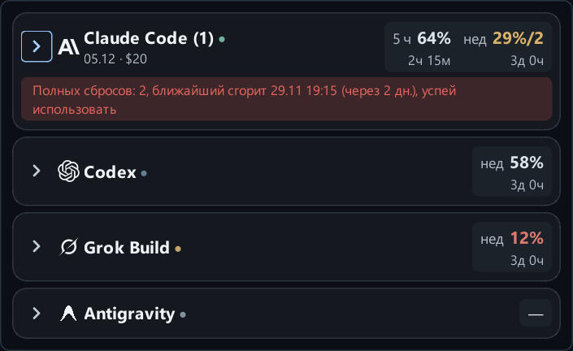
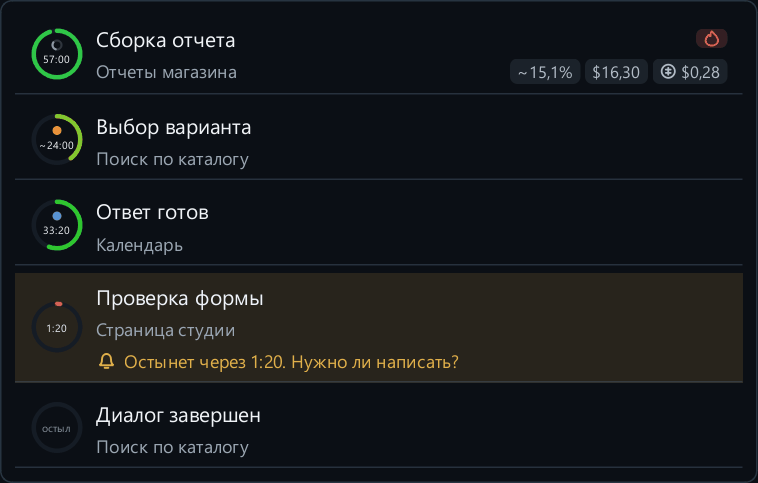
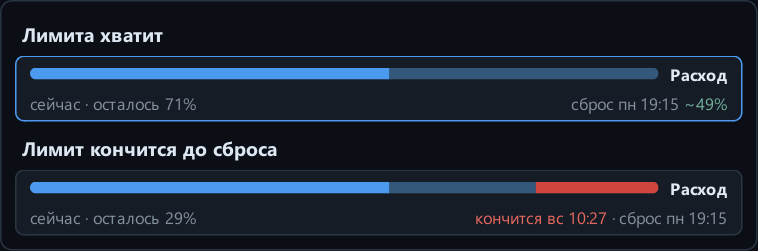
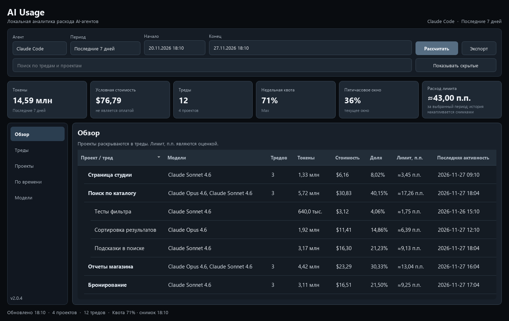

# Как читать индикаторы

[Страница проекта](../README.md) · [Подключение и справка](setup.md)

- [Квоты и состояние источника](#квоты-и-состояние-источника)
- [Кольцо кэша и состояние диалога](#кольцо-кэша-и-состояние-диалога)
- [Расход рядом с диалогом](#расход-рядом-с-диалогом)
- [Недельный прогноз](#недельный-прогноз)
- [Показатели аналитики](#показатели-аналитики)

## Квоты и состояние источника

| Где смотреть | Что означает |
| --- | --- |
| Точка рядом с именем агента | **Зеленая** - источник в состоянии "онлайн". **Голубая** - показаны резервные локальные данные. **Желтая** - показан сохраненный снимок квот. **Серая** - данных нет. Наведите указатель на точку, чтобы увидеть источник, время измерения или причину отсутствия данных. |
| Число в скобках после названия | Например, `Claude Code (1)` означает, что среди показываемых диалогов один выполняется. Счетчик появляется после чтения диалогов, если включены их таймеры. |
| Прямо справа от названия | `5 ч 64%` - осталось 64% пятичасовой квоты. `нед 29%` - осталось 29% недельной квоты. При остатке ниже 50% число желтеет, ниже 20% краснеет. `0%` означает, что лимит исчерпан, прочерк означает отсутствие значения. |
| Под процентом | Через сколько обновится конкретная квота, если известно время сброса. Например, `2ч 15м` относится к пятичасовому окну, а `3д 0ч` к недельному. |
| Суффикс `/2` рядом с процентом | Можно использовать два полных сброса. Выделенная строка под карточкой предупреждает о сгорании ближайшего сброса, если до него меньше 14 суток. При сроке меньше трех суток строка красная. |
| Строка с датой и суммой под именем | Следующий ежемесячный платеж, рассчитанный по дню последней оплаты и сумме из настроек. |
| Стрелка слева | Для Claude Code, Codex и Grok Build раскрывает диалоги, если включены таймеры кэша. У Antigravity открывает список групп или моделей с остатками и сроками сброса. В свернутой карточке Antigravity виден остаток выбранной группы. |
| Часы сверху и строка внизу окна | Часы показывают местное время. `3/4 онлайн` внизу означает, что три из четырех источников находятся в состоянии "онлайн". Рядом видны количество локальных или сохраненных источников и интервал опроса Codex и Antigravity. |

При коротком сбое Codex и Grok зеленая точка может сохраниться до 15 минут. Подсказка показывает время последнего полученного замера в этом случае.

## Кольцо кэша и состояние диалога

**Внешнее кольцо показывает, сколько живет кэш контекста.** Дуга сокращается со временем. При остатке от 60% срока она зеленая, дальше через желтый переходит в красный. Числа внутри - минуты и секунды до остывания. `~24:00` означает примерную оценку. После остывания остается серая окружность с подписью `остыл`. Недавно остывшие диалоги остаются в списке до десяти минут.

**Маленький индикатор над временем показывает состояние диалога.** В компактном режиме он внутри кольца. При отключенном компактном виде индикатор расположен рядом с названием.

| Индикатор | Что происходит |
| --- | --- |
| Серая вращающаяся дуга | Агент выполняет запрос. В примере вращение видно в строке **Сборка отчета**. |
| Оранжевая точка | Агент ждет Вашего ответа, например решения в диалоге. |
| Синяя точка | Последний ход завершен, ответ еще не просмотрен. |
| Индикатора нет | Для диалога нет распознанного состояния работы, ожидания или непросмотренного ответа. |
| Колокольчик и надпись "Остынет через 1:20" | До остывания кэша осталось не больше двух минут. Предупреждение включается в меню **Настроить вид**. |

Под названием диалога может быть виден проект. Среда запуска доступна в подсказке строки. Наведите указатель на кольцо, чтобы увидеть время запроса, расчетный срок кэша и пояснение к оценке.

## Расход рядом с диалогом

На снимке выше справа от проекта видны три оценки.

| Пример | Как читать |
| --- | --- |
| `~15,1%` | Примерно столько процентных пунктов недельного лимита приходится на диалог. Виджет распределяет расход аккаунта между диалогами по стоимости токенов из локальных журналов. |
| `$16,30` | Сколько стоили бы использованные токены по тарифам на программный доступ (API). Знак `+` означает, что для части токенов нет опубликованной цены и они не вошли в сумму. Оплату подписки смотрите у поставщика. |
| Монета и `$0,28` | Цена повторной записи контекста в кэш после его остывания, по оценке. |
| Красное пламя справа от названия | У диалога наибольшая оценка расхода недельного лимита в списке этого агента. |

Плашки появляются при наличии данных. В **Настроить вид** можно выбрать проценты, доллары или оба показателя, скрыть цену остывания и выключить пламя.

## Недельный прогноз

Полоса идет по времени от начала недели до сброса.

- **Ярко-синяя часть** заканчивается в текущем времени. Остаток лимита вынесен в подпись `сейчас · осталось 29%`.
- **Приглушенная синяя часть** показывает оставшееся время с доступным лимитом при текущем темпе.
- **Красная часть** отмечает время между ожидаемым исчерпанием и сбросом. Надпись `кончится` дает расчетное время исчерпания, а `сброс` показывает время обновления квоты.
- **Зеленое число после времени сброса** показывает, какой остаток ожидается к сбросу, например `~49%`. Прогноз меняется вместе с темпом расхода.

Нажмите на полосу или слово **Расход**, чтобы открыть график по проектам. На нем показаны использованный процент, темп в сутки и допустимый расход в сутки до сброса. Доли проектов оцениваются по локальной истории. Escape или кнопка **Закрыть** закрывает график.

## Показатели аналитики

| Где смотреть | Что показывает |
| --- | --- |
| Токены, условная стоимость, треды | Объем обработки, оценку стоимости и число рабочих диалогов за выбранный период. Если клиент не сообщает данные о стоимости, поле может быть пустым. |
| Недельная квота и пятичасовое окно | Уже израсходованный процент текущего окна. Например, 71% в аналитике соответствует остатку 29% в виджете. Для других агентов вместо пятичасового окна может быть показан дополнительный лимит, дата сброса или число модельных пулов. |
| Расход лимита | Оценку расхода за выбранный период в процентных пунктах. Если остаток упал с 80% до 65% без сброса, расход составил 15 п.п. При недостатке измерений появится прочерк. Для Antigravity показатели разных пулов можно посмотреть во вкладке **Модели**. |
| Доля | Часть общей стоимости за период. Если оценки стоимости нет, доля может считаться по токенам. |
| Лимит, п.п. | Оценку расхода квоты, который приходится на выбранный проект, диалог или модель. |
| Последняя активность | Время последней записи о диалоге или проекте из локальной истории. |

На всех снимках использованы тестовые данные.
