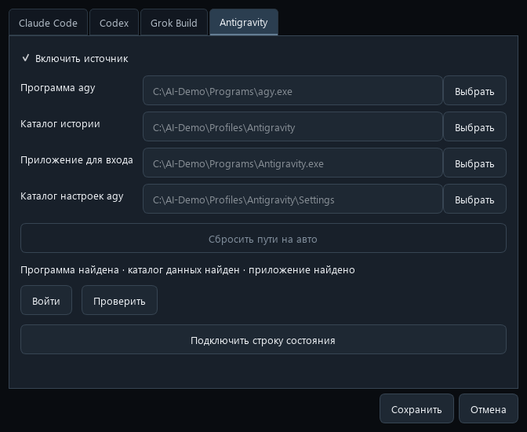
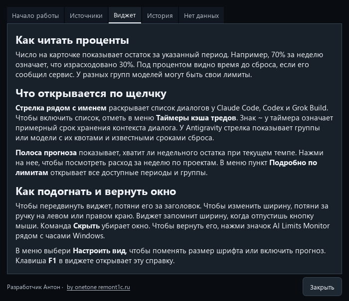

# Подключение и справка

[Страница проекта](../README.md) · [Расшифровка индикаторов](indicators.md) · [Выпуски для Windows](https://github.com/antonnevm-cloud/ai-limits-monitor/releases)

## Подключение четырех агентов

При первом запуске откроется окно **Подключения и вход**. Позже его можно открыть из меню виджета. Можно подключить одного агента и добавить остальных позже.

1. Выберите вкладку нужного агента и отметьте **Включить источник**. Если клиент еще не установлен, кнопка **Страница установки** откроет сайт разработчика.
2. Нажмите **Войти** и завершите вход в официальном клиенте. Вернитесь в виджет и нажмите **Проверить**.
3. Для Claude Code нажмите **Подключить строку состояния**. Для Antigravity она нужна, если отчет `/usage` недоступен или Вы работаете в отдельном профиле.
4. Нажмите **Сохранить**, затем **Обновить** в виджете.

Если программа установлена в нестандартное место, укажите файл клиента в поле **Программа** и папку профиля в поле **Каталог данных**. У Antigravity отдельно указываются программа `agy`, приложение для входа, каталог истории и каталог настроек `agy`. Чтобы вернуться к автоматическому поиску, нажмите **Сбросить пути на авто** и сохраните изменения.

| Агент | Источник квот |
| --- | --- |
| Claude Code | Строка состояния передает данные по пятичасовому и недельному лимитам и сроки сброса, если клиент их сообщил. Для стандартного профиля могут использоваться свежие данные из локальной истории Claude Desktop или поддерживаемого дополнения Claude. |
| Codex | Установленный клиент сообщает доступные периоды квот подписки и сроки сброса. |
| Grok Build | Клиент сообщает недельный лимит. Если источник временно недоступен, виджет может показать последний замер из журнала Grok. |
| Antigravity | В стандартном профиле виджет читает группы квот из отчета `/usage` в поддерживаемых версиях `agy` (клиента командной строки). Для отдельного профиля используется строка состояния. |

После подключения строки состояния откройте новый диалог в Claude Code или новую сессию в `agy`. Проценты появятся после первого измерения. Если в профиле уже настроена другая команда строки состояния, окно подключений сообщит об этом и оставит ее на месте.

Чтобы отключить опрос отдельного агента, снимите флажок **Включить источник** и сохраните настройки.

## Как пользоваться виджетом

- Потяните за заголовок, чтобы переместить окно, или за боковую ручку, чтобы изменить его ширину. Виджет запоминает выбранный размер.
- **Скрыть** убирает окно в область уведомлений Windows. Нажмите значок рядом с часами, чтобы вернуть окно.
- Стрелка у Claude Code, Codex и Grok Build раскрывает диалоги, когда включен пункт **Таймеры кэша тредов** (таймеры хранения контекста). Знак `~` обозначает оценку.
- Стрелка у Antigravity показывает группы или модели, остаток и известное время сброса. Все доступные периоды видны в меню **Подробно по лимитам**.
- Нажмите на полосу недельного прогноза, чтобы открыть расход по проектам. При наведении появляется подсказка. Escape закрывает график.
- В меню **Настроить вид** можно изменить шрифт, прозрачность и видимость отдельных показателей. Справка по F1 работает без интернета.

## Аналитика и история

Нажмите **Аналитика**, выберите агента и период, затем нажмите **Рассчитать**. Отчет показывает данные, которые сохранил выбранный клиент. Кнопка **Экспорт** сохраняет отчет в Excel (`.xlsx`), как веб-страницу (`.html`) или в формате `.json` или `.csv`.

Число на карточке означает остаток. Например, при остатке 70% израсходовано 30%. Если остаток без сброса упал с 80% до 65%, расход равен 15 процентным пунктам. Условная стоимость рассчитывается по тарифам моделей и локальной истории. Сумму к оплате смотрите в самом сервисе.

## Если данных нет

- **Вместо процента прочерк.** Выберите нужного агента в **Подключения и вход**, проверьте путь к клиенту, каталог профиля и вход. Наведите указатель на точку рядом с названием агента, чтобы увидеть источник или причину отсутствия данных.
- **Antigravity прошел проверку, квоты пустые.** Кнопка **Проверить** подтверждает запуск `agy`. Убедитесь, что выполнен вход в самом Antigravity. Если отчет недоступен или выбран отдельный профиль, подключите строку состояния и откройте новую сессию.
- **Пусто за прошлый период.** Виджет накапливает историю квот из измерений. За период до первых замеров данных о расходе квоты может не быть.
